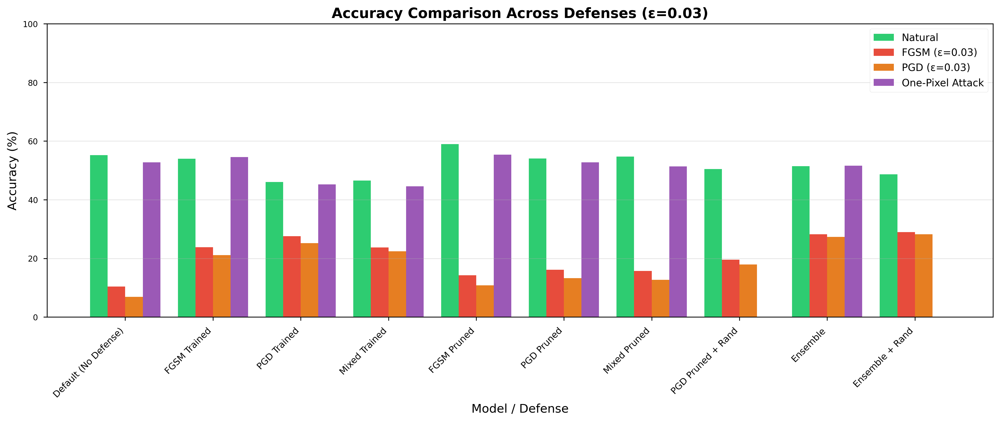

# Adversarial robustness on CIFAR-10

Making a small CIFAR-10 classifier robust to adversarial perturbations, and measuring what each defense costs in clean accuracy.

Team project, M.Sc. IASD, Université PSL, 2025.

## Setup

The architecture is fixed: a small LeNet-style CNN (two convolutional layers, three fully connected layers), which caps clean accuracy at around 55%. The work is in the attacks, the defenses and their evaluation. All numbers below are on 1,024 held-out images.

**Attacks** (`model.py`)
- FGSM, one-step gradient sign attack.
- PGD, 7 iterations, step 0.01.
- One-pixel attack, with differential evolution.

Unless stated otherwise, perturbations are bounded by ε = 0.03 in L∞ norm.

**Defenses**
- Adversarial training on a 50/50 mix of clean and adversarial batches, with FGSM, PGD, or both ("mixed").
- Magnitude pruning followed by fine-tuning.
- An ensemble of the three adversarially trained models.
- Random resizing and padding of inputs at test time.

## Results

Accuracy (%) at ε = 0.03:

| Model | Clean | FGSM | PGD |
|---|---|---|---|
| No defense | 55.2 | 10.5 | 6.9 |
| FGSM-trained | 54.0 | 23.8 | 21.1 |
| PGD-trained | 46.1 | 27.5 | 25.2 |
| Mixed-trained | 46.6 | 23.7 | 22.5 |
| Ensemble of the three | 51.5 | 28.2 | **27.3** |
| Ensemble + input randomization | 48.7 | 29.0 | 28.2 |

- Adversarial training raises PGD accuracy from 7% to 21–25%. PGD training is the most robust single model, but it loses 9 points of clean accuracy.
- The ensemble gives the best trade-off: 27% PGD accuracy for 4 points of clean accuracy.
- Pruning the adversarially trained models recovered clean accuracy, but PGD accuracy fell back to 11–13%. Full table in [`plots/results_summary.md`](plots/results_summary.md).
- The one-pixel attack barely affects this model: 52.8% against 55.2% clean for the undefended network ([`results_one_pixel/`](results_one_pixel)).



**Limitation.** The randomization defense was evaluated with standard attacks. Attacks that average gradients over the randomness (EOT, Athalye et al., 2018) would likely remove most of its small gain, so the ensemble without randomization is the more reliable result.

## Running it

```bash
pip install -r requirements.txt

# adversarial training (CIFAR-10 is downloaded on first run)
python model.py --model-file models/pgd_model.pth --force-train --adv-train --attack-method pgd --num-epochs 10

# evaluate a model against FGSM and PGD
python model.py --model-file models/pgd_model.pth --test-attacks

# evaluate the one-pixel attack
python model.py --model-file models/pgd_model.pth --test-one-pixel --num-pixels 3
```

Trained weights for every model in the table are in `models/`. `generate_plots.py`, `advanced_plots.py`, `generate_one_pixel_plots.py` and `plot_all_attacks.py` rebuild the figures in `plots/`.
